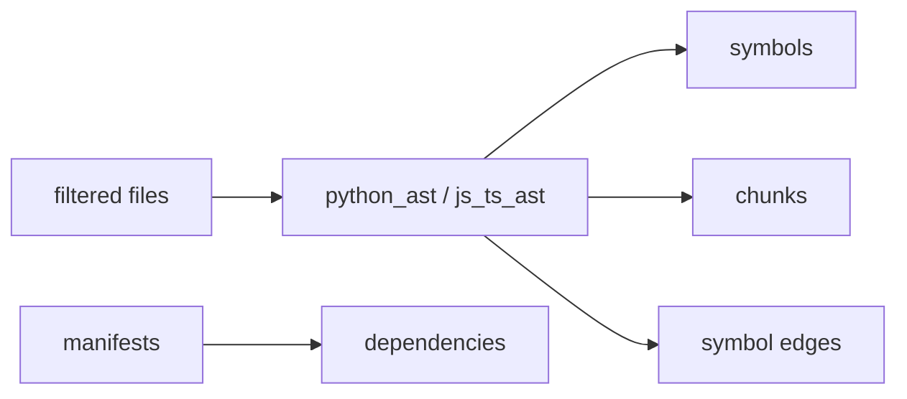

# RepoIntel Architecture

This document describes the real, measured architecture of RepoIntel as it ships.
Every subsystem below corresponds to Python modules under `packages/` and is reachable
through the single public knowledge boundary, `RepositoryFacade`.

## 1. Ingestion Architecture

`packages/ingestion/` turns a repository URL or local path into a filtered working set:

```
repo_url / local_path
   → clone_repository (git clone; local dir copy for evals)
   → filter_repository (.gitignore-aware + binary exclusion + ignored dirs)
   → extract_metadata (languages, manifests, entrypoints, CI configs)
   → detect_archetype (LIBRARY / SERVICE / CLI_TOOL / MONOREPO / UNKNOWN)
```


Repository code is **never executed**. Files are read as data only.

## 2. Parsing Architecture

`packages/parsing/` statically decomposes files:

- `python_ast.py` - Python AST symbol/class/function extraction
- `js_ts_ast.py` - JavaScript / TypeScript parsing
- `chunking.py` - AST-aware line-ranged code chunks
- `symbol_graph.py` - call/import edges between symbols
- `manifest_builder.py` - dependency extraction (`package.json`, `pyproject.toml`, ...)
- `test_parser.py` - test discovery + test→production mapping



## 3. Knowledge Architecture

`packages/knowledge/` persists the parsed model:

- `models.py` - SQLAlchemy async ORM (repositories, files, symbols, chunks, dependencies, commits, graph, artifacts, agent state)
- `persistence.py` - idempotent upsert, scoped invalidation, embedding provenance
- `migrations.py` - Alembic-driven schema evolution (single sanctioned path; never `create_all`)
- `database_validator.py` - `db-check` schema/migration validation

`RepositoryFacade` composes **13+ capability mixins** (`packages/knowledge/facade/`):
history, architecture, testing, risk, impact, graph, search, decision, report,
health, root-cause, simulation, copilot. It is the **only** public boundary.
## 4. Embedding Architecture

`packages/knowledge/embeddings.py` provides an `EmbeddingProvider` abstraction backed
by **sentence-transformers** (local, no API key). Configurable via:

- `EMBEDDING_PROVIDER=local`
- `EMBEDDING_MODEL=all-MiniLM-L6-v2`
- `EMBEDDING_BATCH_SIZE=32`

Every stored embedding is versioned: `content_hash`, `embedding_model`,
`embedding_provider`, `embedding_dimension`, `embedding_created_at`. When the model
or dimension changes, incompatible vectors are invalidated (`invalidate_embeddings_for_model_mismatch`)
and never compared. If embedding initialization fails the failure is reported explicitly
and semantic retrieval is marked unavailable (deterministic lexical retrieval continues).

## 5. Retrieval Pipeline

`packages/knowledge/vector_store.py` implements real retrieval:

```mermaid
flowchart TD
  Q[query] --> LEX[lexical BM25]
  Q --> SEM[semantic vector (cosine)]
  LEX --> MERGE[reciprocal-rank fusion]
  SEM --> MERGE
  MERGE --> RR[reranker]
  RR --> GRAPH[graph expansion (one hop)]
  GRAPH --> CTX[context assembler]
  CTX --> EVD[evidence validation]
```

Every evidence item preserves provenance: repository, file, symbol, chunk,
retrieval source, score, retrieval method.

`semantic_search.py` and `query_understanding.py` provide intent-aware search;
`reranker.py` and `context_assembler.py` provide reranking and bounded assembly.

## 6. Graph Architecture

`packages/knowledge/unified_graph.py` builds a unified knowledge graph of
repositories, files, symbols, and their edges, with bounded traversal
(`MAX_GRAPH_NODES` / `MAX_GRAPH_EDGES`, hop limits) for impact analysis.

## 7. LangGraph Workflow

`packages/agentic/` implements a LangGraph agentic orchestration:

`Planner → Retriever → Reflection(Synthesis ↔ Reviewer) → Finalize`, with conditional
routing on the reviewer verdict (`APPROVE`, `REVISE_SYNTHESIS`, `REVISE_PLAN`,
`NEEDS_HUMAN_REVIEW`) and a bounded reflection iteration budget.

`llm_client.py` is the **only** LLM gateway. Google Gemini is the only provider.
Without `GOOGLE_API_KEY`, deterministic degraded mode is used explicitly
(`llm_available=false`), never fabricating LLM output, confidence, or citations.
## 8. Evidence Pipeline

`evals/evidence_audit.py` and `packages/evals/evidence_audit.py` classify each answer
into `FACTS` / `INFERENCES` / `RECOMMENDATIONS` and verify citations against the
index (file exists, symbol exists, chunk exists, repository identity matches).
Every claim is measured: `total_claims`, `support_ratio`, `citation_validity`,
`evidence_coverage`, `confidence`.

## 9. Persistence & Migrations

`packages/knowledge/migrations.py` + `alembic/versions/` are the single schema
evolution mechanism. Migrations are idempotent and preserve data (marked
`0001..0006`). `create_all` is never a substitute for migrations.

## 10. Runtime Lifecycle & Incremental Indexing

`packages/runtime/` provides:

- `lifecycle.py` - deterministic state machines (CREATED→…→READY / PARTIAL / FAILED)
- `incremental_indexer.py` - per-file content fingerprints, ADDED/MODIFIED/DELETED diffing,
  dependency-aware expansion, scoped cache invalidation
- `recovery.py` - error classification, exponential backoff + jitter, cancellation,
  staged timeouts, degraded mode
- `resource_manager.py` - bounded budgets (files, size, parse workers, embedding batch,
  graph bounds, context tokens, LLM call cap, execution deadline)

## 11. API Architecture

`apps/api.py` (FastAPI) exposes repository creation, analysis, status, artifact
retrieval, chat, symbols, dependencies, graph, groups, commits, impact, copilot.
Long-running analysis runs as a background job (`apps/job_runner.py`) returning a
job ID for status polling. Errors return structured JSON (never raw tracebacks),
with `400 / 404 / 409 / 422 / 429 / 500 / 503` semantics. `/health` liveness and
`/llm-status` (LIVE_LLM vs DEGRADED_NO_LLM) are provided.

## 12. Observability & Security

`packages/shared/telemetry.py` records run ID, repository ID, stage, durations,
retrieval/graph counts, LLM calls, retries, failures, embedding/persistence duration.
`packages/shared/secret_redaction.py` redacts secrets before any repository content is
sent to an LLM (only `redaction_count` is ever recorded, never the secret value).